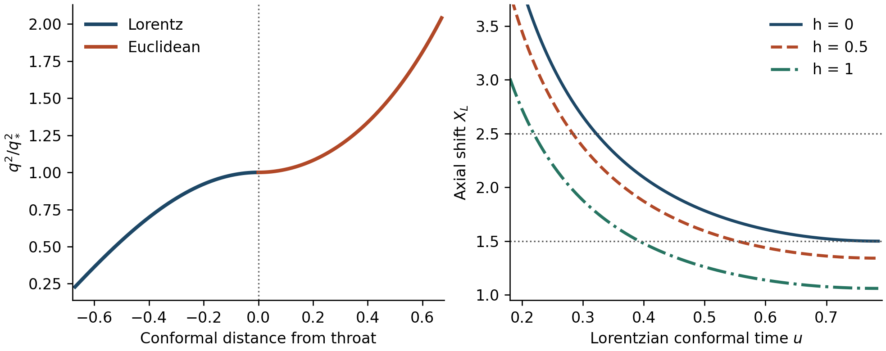

# 第2節　固定電荷と二つの実断面

$`Y=S^3/\Gamma`$ に単位半径の誘導計量、向き、スピンリフトを与え、 $`V=2\pi^2/|\Gamma|`$ と書く。解析接続前の計量の符号は $`(-+++)`$ 、ねじれのトレースは $`T^a{}_{ab}`$ とする。実パラメータ $`h=2\kappa^2 c_H`$ は Paper 08 の規格化で Holst 項の係数を与える。以下のようにおく。

<a id="eq1"></a>

```math
\begin{aligned}
d&=1+h^2,\qquad P=Q_\Sigma=-p_\theta,\qquad s=\mathrm{sgn}\thinspace P,
\\ c&=\frac{|P|}{6V},\qquad a=\sqrt d\,c=q_{\ast}^2,\qquad A_0=\frac{3V}{\kappa^2}.
\end{aligned} \qquad(1)
```

ここでは $`P\ne0`$ とする。作用は Einstein–Cartan 項、 $`\theta\,\mathrm d(e^a\wedge T_a)`$ 、定数係数の Holst 密度、および接続を消去した後の計量境界項からなる。一様な時間的ソースに対してトレース成分と軸性成分の方程式を解くと、ローレンツ固有時における軸性係数は $`j=-\kappa^2\dot\theta/d=s c/q^3`$ 、ベクトル係数は $`-hj`$ となる。補助接続の無次元 Hessian の行列式は $`256d^{12}`$ である。その Schur 補元から、ローレンツ符号のスカラー密度 $`-C(\nabla\theta)^2`$ が得られ、係数は $`C=3\kappa^2/d`$ である。 $`h=0`$ では正準スカラーは $`\sqrt6\,\kappa\theta`$ で、コントーションに入るのは $`\kappa^2\theta`$ の微分である。特に $`h`$ が非零の場合、保存される NY 電荷と場の速度に対する積分定数を区別する必要がある。

一様なモードに対する Legendre 変換は $`p_\theta`$ を固定するので、スカラーは正の流束ポテンシャルを通じてユークリッド作用に入る。ラプスを $`N`$ とし、 $`N=1`$ で固有動径座標を用いる。外端の誘導計量が定める半径を $`R`$ とし、平坦な基準空間の境界曲率を用いると、作用は次のようになる。

<a id="eq2"></a>

```math
I_P=A_0\int\left(-\frac{q\dot q^2}{N}-Nq+\frac{Na^2}{q^3}\right)\mathrm d\tau+A_0 R^2 . \qquad(2)
```

内端の反射面では外部曲率が零である。 $`N`$ を1に固定する前に変分すると $`\dot q^2=1-a^2/q^4`$ を得る。したがって喉での外向き固有加速度は $`2/q_*`$ である。共形ユークリッド時間 $`\mathrm d\tau=q\,\mathrm d t`$ を用いて積分すると、

<a id="eq3"></a>

```math
q_E^2=a\cosh(2t),\quad 0\le t\le T,\qquad
 T=\tfrac12\mathrm{arcosh}(R^2/a). \qquad(3)
```

となる。正の半径のローレンツ切片では $`(\mathrm d q/\mathrm d\tau_L)^2=a^2/q^4-1`$ が成り立ち、 $`\mathrm d\tau_L=q\,\mathrm d u`$ とすれば解は $`q_L^2=a\sin(2u)`$ である。解析接続 $`u=\pi/4-it`$ は、一階微分が消える面で二つの実計量を接合する。ローレンツ時間で半径が最大となる面は、実ユークリッド半径の最小面である。正定値のユークリッド計量は複素計量の固有値の位相に関する許容条件を自動的に満たす。この計量だけの判定からは、スカラー場の背景微分が虚数のとき、そのまわりのアクシオン摂動に対する実の積分路は決まらない。

閉じた空間流束は、正則なカラーに沿って一定である。外向きの境界の向きを用いると、Nieh–Yan 全微分の積分に現れる両端の流束積分は相殺する。したがって一方の開口部は $`P`$ を担うが、この境界値問題で整数の四次元電荷が固定されるわけではない。式(2)に拘束を代入すると、正則化された Hamilton の主関数が得られる。

<a id="eq4"></a>

```math
\begin{aligned}
\frac{I_P(R)}{A_0}&=R^2-2\int_{q_{\ast}}^R q\sqrt{1-a^2/q^4}\,\mathrm d q
\\ &=R^2-\sqrt{R^4-a^2}+a\arccos(a/R^2).
\end{aligned} \qquad(4)
```

無限遠では $`I_P^\infty=\pi A_0 a/2=\pi\sqrt d\,|P|/(4\kappa^2)`$ となる。総電荷を固定すればこの値は商を定める群の位数に依存せず、密度を固定すれば $`V`$ に比例する。 $`q_*`$ を固定すると無限端作用は $`h`$ に依存しない。有限の外半径 $`R`$ の絶対値を固定する場合に使うべき式は式(4)である。喉と一緒に $`R`$ を変える操作は、外端の境界計量も変える。



**図1.** 左は、ローレンツ側の膨張とユークリッド側の外向きのカラーについて、面積半径の二乗を $`a`$ の単位で反射面からの共形距離に対して示したもの。右は $`h=0,1/2,1`$ でのローレンツ側の軸性シフト。水平破線は絶対値が最初と二番目に小さい殻エネルギーを示す。 $`h=0`$ では最初の交差と反射面の間の開区間は空である。[図の PDF 版](LaTeX/figures/throat.pdf)

[英語原文](LaTeX/sections/sec02.tex)

[← 第1節](DPPUv8-paper09_sec01.md)　[目次](README_ja.md)　[第3節 →](DPPUv8-paper09_sec03.md)
